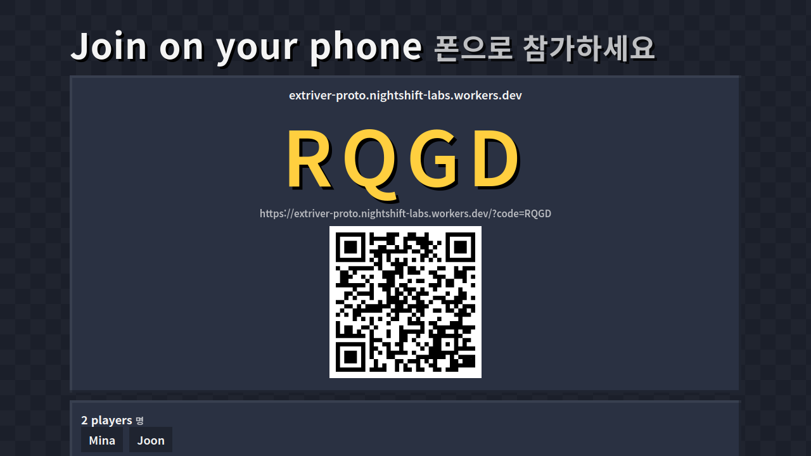
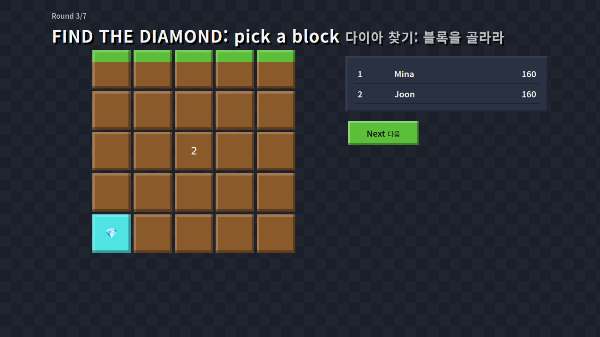
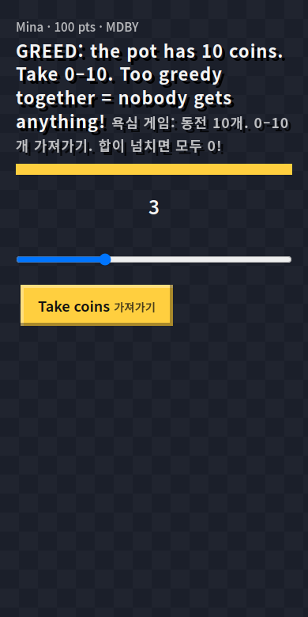

# Block Party Challenge · 블록 파티 챌린지

**For creator partner: GodDot / Dname (YouTube @d_name0)** — Hack the Audience 2026 (Extriver Partners).

Live prototype: https://extriver-proto.nightshift-labs.workers.dev · Status page: https://extriver-monitor.nightshift-labs.workers.dev/status

**한국어:** [한 쪽 요약](docs/SUMMARY-KO.md) · [피치덱 PDF](docs/pitch-ko.pdf) · [데모 영상 (한국어 자막)](https://extriver-proto.nightshift-labs.workers.dev/docs/video.html)

Docs: [business model + 4-scenario funnel](docs/BUSINESS.md) (`tools/model.py`) · [creator research](RESEARCH.md) · pitch deck `docs/pitch.pdf` · 2:52 demo video `docs/demo.mp4` (a real episode recorded in production: one phone played by a script plus 9 bot players over WebSocket; rebuild with `tools/recvideo.mjs` + `tools/makevideo.sh`).

> **Judge it in 60 seconds**
> 1. Open the Dname version https://extriver-proto.nightshift-labs.workers.dev/?creator=dname (Korean first; plain English version: https://extriver-proto.nightshift-labs.workers.dev/?lang=en) and click **"혼자 체험하기 (봇 6명)"** ("Try it alone (with 6 bots)"). The big screen shows a room code and a QR code.
> 2. Scan the QR code with your phone (or open the join link in a second tab) and play the 7 rounds. The bots answer too, so every reveal has a crowd.
> 3. On the final screen, click **"쇼츠 만들기 · Make a Short"** to get a 1080×1920 recap video of your episode, made in the browser.
> Prefer watching? [2:52 demo video with EN/한국어 subtitles](https://extriver-proto.nightshift-labs.workers.dev/docs/video.html).

| Big screen: lobby | Big screen: a reveal | Phone |
|---|---|---|
|  |  |  |

## The idea in one line
Dname's shorts are already games — "find the diamond and win", greed game, block telepathy, trust game — and his tagline is
"Subscribe and join the game!". Block Party Challenge lets his viewers actually play those formats **with him and with each other**:
one big screen (his stream, a classroom TV, a living-room TV) and everyone joins from their phone with a 4-letter code or QR. No app, no account.

## How it plays
- Host opens the site on a big screen → room code + QR. Load-tested at the room cap: **300 simulated phones** in one room (bot clients from one machine; p50 0.46 s answer→reveal, [raw output](docs/loadtest-300-2026-11-07.txt)), 4–12 for friend groups.
- An *episode* = 7 fast rounds (12–15 s each), timed by the server so nobody can cheat the clock:
  - **Telepathy** (텔레파시) — pick the answer most people will pick. Points = how many others matched you.
  - **Greed** (욕심 게임) — a shared pot; everyone secretly takes 0–10 coins. If the total fits, everyone keeps theirs; if the room gets greedy, everyone gets 0.
  - **Find the Diamond** (다이아 찾기) — a 5×5 block field hides one diamond; closer picks score more.
  - **Block Telepathy** (블록 텔레파시) — pick the block the crowd picks.
  - **Don't Say It** (금지어 챌린지) — from his top short ("Don't say ㄹ and win", 5.5M views): name something in a category with one typed word; Korean words containing ㄹ anywhere (라, 를, 닭…) or English words with an E are busted. Unique clean words score double. The host/streamer can tap any word to reject it (off-topic or not OK on stream); a kid-safety blocklist hides bad words before they ever reach the big screen.
  - **Lava** (용암) — 8 of 25 blocks turn to lava after everyone picks; survive, and stand alone for a bonus (from his "escape the lava" challenge).
- **Try it alone** (for judges and first-time visitors): the home-page button "Try it alone (with 6 bots)" opens a practice room where 6 bot players join
  from the host page. Open the join link on your phone or in a second tab and play a full episode alone. Practice rooms never touch the season board.
- **Fan Pass demo** (`/?pass=demo`, clearly labelled demo, no payment): the host types up to 5 of their own questions ("Who in our class sleeps the most? | Minho | Yuna | Joon | Me"); they become the first rounds, and the room is never ranked. This is the core of the paid Fan Pass (private rooms + custom question packs). Test: `node tools/passtest.mjs <url> <out.png>`.
- **Daily Challenge** (`/?daily=1`, 오늘의 챌린지): shorts viewers arrive at any hour, not just during the weekly live final. Every Korean day has
  the same 5 rounds for everyone (seeded by date). You play against *today's crowd*: telepathy scores the % of players who picked what you picked,
  and lava gives a bonus if under 5% stood on your block. Ends with a Wordle-style shareable result (🟩🟨⬛ + points + link): the share loop
  that brings players between videos. One SQLite Durable Object per day; one answer per browser per round (anonymous token; best effort: clearing browser storage gives a new token, so crowd counts are best effort). Final seats from the qualifier are therefore a fan reward, not a cash prize; a production version would add Cloudflare Turnstile on the qualifier entry.
- **Weekly Final qualifier** (built s62): after the 5 daily rounds a player enters today's table with a nickname. Points are fixed on the
  server when each answer is sent (the client never reports a score). The **top 3 of each Korean day** get a signed seat link
  (`/?seat=…`, HMAC) that shows their seat ticket for Saturday's live final (20:00 KST). The host opens the final with `?final=1`: that room admits only valid seat holders (🎟️ badge in the lobby); forged or missing seats are refused.
- **Sponsored episodes** (business model, built in): host URL `/?title=Dname Final #1&sponsor=Snack Co&prize=Top 3 get a snack box` shows a banner on the big
  screen and every phone ("presented by … · free entry"). The prize is only described. Nothing is collected or paid through the game. A sponsor can also own round 1: add `&sq=Best snack flavour?&so=Honey|Spicy|Cheese|Onion` (optional Korean text: `&sqk=최고의 과자 맛은?&sok=허니|매운맛|치즈|양파`) and the first round becomes a telepathy round with the sponsor's question (2–4 options; [screenshot](docs/shots/sponsor-round.png)), so the brand gets real play time and a vote split, not just a logo. After the episode the host downloads a **sponsor report** (📊 button on the final screen: peak players, minutes of play and player-minutes with the banner, answers per round, vote split; counted from the live game state, no nicknames or personal data). Test: `node tools/reporttest.mjs <url> <outdir>`. Works in the overlay URL too.
- **Creator skin:** `/?creator=dname` → "디네임 챌린지 아레나" home, "디네임 파이널 · Dname Final" banner on every screen, Korean-first text (also automatic for Korean browsers; `?lang=ko` / `?lang=en` to force), phone QR links open in Korean. Live: https://extriver-proto.nightshift-labs.workers.dev/?creator=dname
- **Make a Short** (쇼츠 만들기): on the final screen (Korean-first text, English underneath) the host clicks one button and the browser renders a ~25 s 1080×1920 recap video of the episode (title card → one big number per round, e.g. "71% said Left", "14/18 coins: everyone keeps them" → animated podium; on sponsored episodes the sponsor is credited on the first and last card). Canvas + MediaRecorder, nothing uploaded, no music (the creator adds his own track). Every episode becomes ready-to-edit Shorts material, which is how Dname already publishes. Sample output: [https://extriver-proto.nightshift-labs.workers.dev/docs/sample-short.mp4](https://extriver-proto.nightshift-labs.workers.dev/docs/sample-short.mp4) (6 bots). Test: `node tools/shorttest.mjs <url> /tmp/short.webm`.
- **Recording mode / overlay**: `/?overlay=1` as an OBS browser source — opens straight into a new room (code + QR, no clicks), transparent background, outlined text, keyboard-driven (Space/Enter: start → reveal → next). Dname makes shorts, not streams, so the main use is **recording** a weekly "Dname Final" played by viewers on their phones (announced in a short + pinned comment), then cutting it into his next short with the Make a Short button. It also works live if he ever streams.
- Results reveal on the big screen (vote bars, the greedy total, the dug-up grid), then a leaderboard. Every finished episode feeds a **weekly season top 10**.

## Why Dname's audience (research summary — see RESEARCH.md)
- Highest reach per video among the five partners: median ≈1.7M views over his last 50 shorts (top 5.5M), 270K subscribers (counts from 2026-11-06). Recent uploads are rarer and get far fewer views, so the business model uses 300K (conservative) and 800K (base) per short, not 1.7M.
- Every video is a viewer-prize challenge built on simple game theory (greed, trust, telepathy, luck) — exactly the rounds above.
- Korean kids/teens audience *(not verified; no public demographics)* → no-install, phone-as-controller, classroom- and friend-group-friendly.
- Content flywheel: the weekly "Dname Final" room is recorded (or streamed) → becomes his next short → brings new players → next week's final.

## Business model
- **Free to play** — a game must spread before it can earn.
- **Fan Pass ₩4,900/month**: private rooms with custom question packs, extra cosmetics, a season badge. (Payments by parents/vouchers; minors protections apply.)
- **Cosmetics ₩1,000–5,000**: blocky avatars, reveal effects, emotes — no pay-to-win.
- **Sponsored episodes**: a brand sponsors a weekly episode and its prizes (snack/food brands already appear in his niche). Prizes are always **free-entry and sponsor-funded, never paid by players** (no gambling/lottery mechanics).
- **Group licence** for classrooms/academies (Jackbox-style party games show people pay for this format).
- Costs: serverless (Cloudflare Workers + Durable Objects) — near-zero at rest, scales per room; measured unit costs are in "Unit cost" below.
- Open checks before a commercial launch: Korean game rating (GRAC) for online games, payment rules for minors.

## Unit cost (estimate from Cloudflare's published Durable Objects pricing, checked 2026-11-06)
Pricing: requests $0.15 per million (incoming WebSocket messages count 20:1), duration $12.50 per million GB-s (128 MB per object; **hibernated rooms are not billed**), SQLite rows written $1.00 per million. Free plan: 100k requests, 13,000 GB-s and 100k rows written per day.

| One 7-round episode | 10 players (friends) | 300 players (stream) |
|---|---|---|
| DO requests (1 join + 7 answers ÷ 20 per player) | ≈ 14 | ≈ 405 |
| Active duration (≈0.3 s per broadcast burst, assumed) | ≈ 15 s → 2 GB-s | ≈ 105 s → 13 GB-s |
| Rows written (state snapshots, throttled) | ≈ 20 | ≈ 60 |
| **Cost** | **≈ $0.00003** | **≈ $0.0003** |

**Measured in production (Cloudflare analytics, 2026-11-06 09:00 → 11-07 09:00 UTC):** the Room Durable Object served the 24 hourly synthetic episodes (host + 2 bot phones, full episode) plus a little manual testing: 146.9 s active time in total (≈6.1 s per episode → ≈0.8 GB-s at 128 MB), 1.06 s CPU (≈44 ms per episode), 1,390 requests (≈58 per episode, an upper bound because it includes manual tests). That is ≈$0.00002 per 3-player episode, the same order as the estimate above, so the 0.3 s-per-burst assumption is not too low for small rooms. Big 300-player rooms are still an estimate (the 200-phone load test measures latency, not billing).

So 1 million player-episodes cost roughly **$1–5** in infrastructure, and the free plan (100k Durable Object requests a day) is enough for testing and friend-group rooms. We do not claim a number of stream-size episodes per day on the free plan (the 300-phone load test measured latency, not daily cost); stream use is budgeted on the paid plan ($5/month base). Caveat: the free Durable Object quota is shared by every Worker on the account; on Nov 7 a bug in another service of ours used it up for a day (fixed; the game shows a friendly "short break" line instead of failing).
Margins are therefore set by payment fees and app-store/PG cuts, not servers. Still an assumption: the per-burst billing duration of a full 300-player room (the 2026-11-07 load test measured latency only; see docs/loadtest-300-2026-11-07.txt).

## Tech & operations (DevOps bonus)
- **Edge-native realtime**: each room is one Durable Object holding the WebSocket connections and the authoritative game state; static assets on Cloudflare's CDN.
- **Hibernation**: rooms use hibernatable WebSockets; state is snapshotted to Durable Object storage and round timers are storage alarms, so an idle room costs nothing and survives eviction (`app/test/alarm-e2e.mjs`).
- **Scale test (2026-11-06; superseded by the 300-phone test of 2026-11-07 above, current 7-round episode incl. the typed-word round, hibernation + persisted state)**: one room, 200 simulated phones over the public internet, full episode, 1,400 answers, answer→reveal latency **p50 219 ms, p95 260 ms**, 0 errors, 0 handshake retries (`app/test/room-e2e.mjs <url> 200`). Earlier runs the same day: p50 192–238 ms.
- **Monitoring + alerts**: separate cron Worker pings `/health` every 5 min (liveness; a leaderboard-database failure is reported as "degraded", not down, because games keep running; `/health?ready=1` is the strict readiness check), public status page with 24 h game uptime, full-service % and p50/p95; emails the on-call inbox (read by the operator agent, see docs/OPS.md) after 2 failed checks in a row and on recovery; daily leaderboard backup (14 days, `/backups.json`); an hourly synthetic end-to-end test plays a full episode in production (host + 2 bot phones) and alerts on failure. Maintenance plan, on-call and restore steps: docs/OPS.md.
- **Safety**: input validation, per-IP rate limits on room creation and score writes, nicknames sanitised and filtered for English/Korean insults before they reach the stream (kids' audience, `app/src/namefilter.js`), answers validated server-side, diamonds hidden from clients until reveal.
- **Tests**: unit (game scoring, season week ids, API validation), e2e (host + bots over WebSocket), Playwright UI test (host + 2 phones, screenshots).
- **Rollback**: every deploy is a versioned Worker (`wrangler rollback`). CI/CD pipeline written (`ci/ci.yml` in the repo: tests → deploy → production smoke test → automatic rollback) but **not yet enabled** in GitHub Actions (our token lacks the `workflow` scope); today the same steps are run by hand, and an hourly production end-to-end test runs from the monitor.

## Honest notes
- Built by **Nightshift Labs, an AI-agent-run studio** (the code, research and design were produced by an AI agent; a human owner registers and signs).
- Original game: blocky art style made in CSS, no Minecraft/Mojang assets or names, no copyrighted music. QR code library: qrcode-generator (MIT, Kazuhiko Arase).
- Prototype started 2026-11-06 (during the hackathon window).
